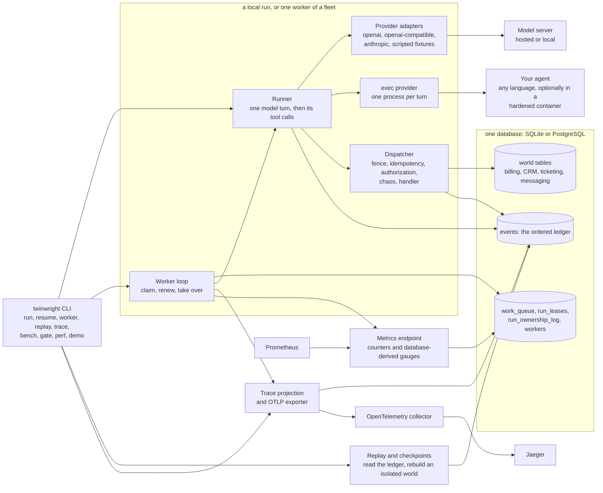
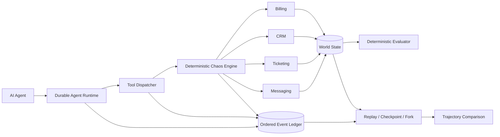

# Architecture

How Twinwright is put together, in four views: the components, the path of one tool call through the code, the trust boundaries, and the index of the architecture decision records. [claims.md](claims.md) lists the test or CI job behind each claim made here and in the README. Where nothing holds a statement, this page says so.

## Components

| Component | Where | What it does |
| --- | --- | --- |
| CLI | `cmd/twinwright` | Every command. `run` and `resume` execute in this process under a local lease; `worker` claims queued runs. |
| Runner | `internal/agent/runner.go` | Records a model request, asks the provider for the next turn, validates its tool calls, commits the turn, and hands each call to the dispatcher. Retries an interrupted provider attempt once. |
| Provider adapters | `internal/agent` | Map a vendor response into Twinwright's message shape. The world, dispatcher and evaluator never see vendor details. A recording transport and a cassette transport wrap the HTTP client. |
| exec provider | `internal/agent/exec.go`, `execcontainer.go` | Starts the agent you wrote, once per turn, and exchanges one JSON request and one JSON response. |
| Dispatcher | `internal/dispatch` | Executes one tool call inside one database transaction. Authorization and chaos live here, in code, not in a prompt. |
| World store and ledger | `internal/store` | SQLite or PostgreSQL. World tables, the ordered event ledger, saved tool results, the transcript, and the queue and lease tables. |
| Queue and workers | `internal/worker`, `internal/store` | Claim a run under a fenced lease, renew it, take over an expired one, finish or requeue. |
| Replay and checkpoints | `internal/replay`, `internal/checkpoint`, `internal/fork` | Rebuild an isolated world from the ledger and compare. Replay through a cassette also runs the real adapter. |
| Trace exporter | `internal/trace` | Projects the ledger into spans and posts them as OTLP/HTTP JSON. Derived after the fact, so it never changes the database. |
| Metrics | `internal/metrics` | Prometheus text exposition: in-process counters plus gauges read from the database at scrape time. |
| Collector, Jaeger, Prometheus | `docker-compose.yml`, `deploy/` | The observability stack. Compose starts them, pinned, on loopback, with no TLS and no authentication. |

## The single-process view

This is the content of the README's former "Architecture" section, moved here unchanged apart from a link adjustment.

World construction is intentionally explicit: OpenAPI contracts plus behavior
bindings plus a world definition go through the Twinwright compiler into a versioned
world manifest, which is what an isolated executable world is created from.

OpenAPI defines **callable shapes**, not business semantics. Twinwright keeps those concerns separate instead of pretending an API schema can infer real application behavior.

That diagram is the single-process picture. Twinwright also runs a fleet of workers over one database, with leases, fencing and takeover after a crash: [docs/distributed.md](distributed.md) has the topology, the takeover sequence and the lease lifecycle.

## The path of one tool call

One model turn proposes a tool call, and the runtime turns it into one committed transaction. The functions are named so that this page can be read against the code.

1. `Runner.Execute` (`internal/agent/runner.go`) loads the run and its transcript. If the last assistant turn holds a call with no tool message yet (`pending`), it goes straight to step 6, which is how a resumed run avoids repeating a committed call. Otherwise it needs a model turn.
2. `authz.Exposed` lists the operations the principal could call next. The model is only offered those. This is a convenience, not the control: step 6 denies a hidden operation called directly.
3. `startModelCall` appends `model.request` through `Store.AppendGuarded`, a write that first proves lease ownership. A request left over from a crashed attempt is reused, not duplicated.
4. `Runner.callProvider` calls `Provider.Next(ctx, task, history, ops)`. For a vendor adapter that is one HTTP request. For `ExecProvider.Next` it is one agent process: the request goes to its stdin and one JSON response comes back from its stdout. An interrupted attempt (a timeout, a truncated completion, a 429, a 5xx or a dropped connection) is retried once and every attempt is recorded.
5. `validateCalls` rejects a call without an ID, with an operation that is not compiled, or with an ID already used in the run. `Store.SaveTurnGuarded` then commits the assistant turn, its step and the transcript in one fenced transaction.
6. `Dispatcher.Invoke(ctx, runID, callID, operationID, args)` (`internal/dispatch/dispatch.go`) opens one transaction and, in this order:
   - `store.GuardFenceTx` proves this worker still owns the run. The presented fence must be at least the highest fence that has committed, and the lease must not have expired. It runs before anything else, including the idempotency lookup, so a worker that was fenced out cannot even read the run's saved results.
   - Looks the (run, call ID) pair up in `tool_results`. The same operation and arguments return the saved result and commit nothing. The same call ID with different arguments is refused.
   - Appends `tool.request` to the ledger.
   - `validate` checks the arguments against the compiled operation, and `authz.Decide` makes the authorization decision: permission, resource scope, refund cap, temporary grants and revocations. It appends `authorization.allowed` or `authorization.denied`. A denial yields a 403 and skips both chaos and the handler.
   - `chaos.Decide` finds the fault rule that matches the call, if any (an error before execution, latency, a stale read, a write that commits and then loses its response, and so on) and appends `chaos.injected`.
   - The handler found by `behavior.Registry.Lookup` runs against the same transaction. It changes the world tables and returns a status, a body and a mutation record.
   - Appends `state.mutation` and `tool.response`, inserts the `tool_results` row, and appends the tool message to the run's transcript. All of these use the same transaction through `store.AppendEventTx`.
   - The `before-tool-commit` crash point fires, then `tx.Commit()`, then `after-tool-commit`.
7. The commit is the only moment the call becomes durable. The effect, its ledger events, its saved result and its transcript entry exist together or not at all, and a process that dies on either side of the commit is recovered by another worker (`TestCrashPointsLeaveTheDocumentedDurableState`). The loop goes round again, `pending` finds the tool message, and the provider is asked for the next turn with the result in its history.

What the path does not do: the ledger never records which worker ran the call (ownership history is in `run_ownership_log`), and effects outside the world store, such as provider spend, logs and metrics, are not fenced. Delivery is at-least-once, never exactly-once: a crash before a model response is recorded repeats the provider call and its cost, and a retry with a new call ID is a new action that nothing deduplicates. ADR 0029 states this precisely.

## Trust boundaries

Four boundaries matter. For each: what the other side may do, what it may not, and what holds that.

### The agent process

Applies to `--agent exec`. The process is yours; it is not trusted.

- It may read the task, the history as the ledger records it, and the operations the run exposes. It may propose tool calls or a final answer.
- It may not execute anything: the dispatcher authorizes and executes, so a policy holds whatever the agent proposes (`TestExecAgentCannotExceedThePrincipalsPolicy`).
- It does not receive the database address or the provider keys. Its environment is `PATH`, `HOME` and the variables named with `--agent-env` (`TestExecChildEnvironmentIsMinimal`). It writes at most 1 MiB to stdout before it is killed, and the tail of its stderr is kept and redacted.
- Without `--agent-container`, it runs with the operator's privileges. Twinwright does not stop it reading files or opening connections. That is the limit of this boundary.
- With `--agent-container IMAGE`, it runs under `docker run --rm -i --read-only --cap-drop ALL --security-opt no-new-privileges --user 65534:65534`, with `--network none` unless `--agent-network` names one, and memory, CPU and process caps (`TestContainerWrapIsHardened`, and `TestPythonAgentInHardenedContainer` against a real daemon in the Integration workflow). The Docker daemon is trusted, there is no custom seccomp profile, an allowed network is unrestricted, on macOS and Windows the boundary is the Docker Desktop VM, and a container is left running if Twinwright itself is killed mid-turn (a turn that times out, is cancelled or floods its output has its container removed, `TestHardenedContainerIsGoneAfterOverflowAndTimeout`; ADR 0033).

### The model provider

The provider is a remote service that receives the task, the history and the operation list over HTTP, and returns text and proposed calls. Its output is untrusted data.

- It may influence what the agent proposes. It may not widen the principal's permissions, because authorization does not read the transcript (`TestInjectedTicketIsUntrustedServiceData`).
- The API key travels only in the request header. The configured key is masked in each output item before the item is interpreted, as written and as the server's JSON escapes it (`TestSuccessfulOutputIsRedacted`, `TestSuccessfulOutputIsRedactedWhenEscaped`), error bodies are redacted (`TestProviderErrorReachesTheLedgerWithoutTheKey`), and transport errors lose their URL userinfo and query (`TestTransportErrorHidesURLQueryAndUserinfo`, `TestMalformedBaseURLNeverLeaks`). Cassettes record no request headers.
- A cassette holds the prompts and answers of a real run. It is not a secret-free artifact; do not commit one.
- Truncation detection depends on the provider sending its stop reason. A surface that omits it, or a gateway that rewrites it to a success value, gives nothing to check.

### The database

The database is the integration point. A worker that can open it with the DSN is trusted code.

- Fencing protects against a stale worker, not a malicious one: a process with write access to the database can alter anything in it. The DSN carries credentials, so pass it through the environment or a secret manager, not a shell history.
- Replay, `inspect`, `trace`, `evaluate`, `queue` and `doctor` open the database read-only. For SQLite that means no create and no migrate (`TestOpenReadOnlyDoesNotCreateOrMigrate`, and for the last three on a database one migration behind, `TestReadCommandsDoNotMigrateTheSource`), though a read-only open in WAL mode still creates `-wal` and `-shm` files, so they need a writable directory. A missing path is an error that names it (`TestReadCommandsRefuseAMissingDatabase`). For PostgreSQL the connection sets `default_transaction_read_only=on`, which makes the server refuse a write; no test attempts such a write, so that part is unverified.
- All runtime SQL uses bind parameters. The one interpolated identifier is the `search_path` schema name, validated against a plain-identifier pattern first (`TestSearchPathSchemaRejectsAnythingButAPlainIdentifier`).
- The ledger records what the agent did and never who ran it. A fenced-out worker cannot commit (`TestGuardFenceRejectsStaleWorkerAfterTakeover`).

### The observability stack

The collector, Jaeger and Prometheus receive data derived from the ledger and the queue.

- Spans are projected from the ledger with the configured secrets redacted (`TestBuildRedactsConfiguredSecret`). Export is best effort and never changes a claim's disposition. A failed export is logged with credentials scrubbed (`TestWorkerExportFailureWarnsWithoutLeakingCredentials`).
- **The stack has no TLS and no authentication.** Compose publishes every port on loopback only. The metrics endpoint is unauthenticated and off by default, and it exposes queue depth, run counts and ownership topology.
- `make demo-stack` is an exception while it runs: its two metrics listeners (ports 9095 and 9096) bind all interfaces, because the Prometheus container reaches the host through the bridge gateway. Do not run it on a machine whose network you do not trust.
- Nothing proves that a collector other than the pinned one, or a backend other than Jaeger, accepts the export.

[SECURITY.md](../SECURITY.md) is the policy, and [security-review.md](security-review.md) is the review pass over each internal boundary, with the test behind each claim and the places where no test holds one.

## Architecture decision records

All 34 records in `docs/adr/`. Each says what was decided, what was rejected, and the limits that came with the decision.

| ADR | Title | Status |
| --- | --- | --- |
| [0001](adr/0001-go-sqlite.md) | Go runtime with SQLite state | accepted |
| [0002](adr/0002-openapi-bindings.md) | OpenAPI plus explicit behavior bindings | accepted |
| [0003](adr/0003-ledger-checkpoint.md) | Atomic local tool effects and checkpoints | accepted |
| [0004](adr/0004-replay-verification.md) | Isolated verification replay | accepted |
| [0005](adr/0005-company-world.md) | Explicit multi-service company world | accepted |
| [0006](adr/0006-world-definition.md) | Versioned multi-service world definitions | accepted |
| [0007](adr/0007-checkpoint-fork.md) | Verified checkpoints and isolated forks | accepted |
| [0008](adr/0008-chaos-engine.md) | Persisted deterministic chaos rules | accepted |
| [0009](adr/0009-principal-authorization.md) | Runtime principal authorization | accepted |
| [0010](adr/0010-declarative-assertions.md) | Declarative run assertions | accepted |
| [0011](adr/0011-counterfactual-analysis.md) | Counterfactual intervention analysis | accepted |
| [0012](adr/0012-ledger-traces.md) | Ledger traces | accepted |
| [0013](adr/0013-agent-providers.md) | Multiple agent providers | accepted |
| [0014](adr/0014-twinwright-bench.md) | Twinwright Bench | accepted |
| [0015](adr/0015-shadow-mode.md) | Experimental shadow mode | accepted |
| [0016](adr/0016-optional-containers.md) | Optional containerized world sidecars | accepted |
| [0017](adr/0017-distributed-runtime-deferred.md) | Distributed runtime is not claimed yet | accepted; superseded in part by ADR 0018, completed by ADR 0019 and ADR 0020 |
| [0018](adr/0018-lease-fencing.md) | Lease ownership with fencing tokens | accepted; superseded by ADR 0020 |
| [0019](adr/0019-postgres-storage.md) | PostgreSQL storage backend | accepted |
| [0020](adr/0020-multi-worker-runtime.md) | Multi-worker runtime, leases in the world store, and fencing | accepted; supersedes ADR 0018, completes ADR 0017 |
| [0021](adr/0021-otlp-and-metrics.md) | OTLP delivery and runtime metrics | accepted; extends ADR 0012 |
| [0022](adr/0022-shadow-connectors.md) | Shadow observation connectors | accepted; extends ADR 0015 |
| [0023](adr/0023-distributed-and-counterfactual-bench.md) | Distributed and counterfactual benchmark modes | accepted |
| [0024](adr/0024-container-hardening.md) | Container lifecycle hardening | accepted; extends ADR 0016 |
| [0025](adr/0025-honest-bench-aggregation.md) | Honest bench aggregation: negative controls, errored cases, and writer attribution | accepted |
| [0026](adr/0026-shadow-comparison-depth.md) | Shadow comparison depth: semantic, timing and policy divergence | accepted |
| [0027](adr/0027-provider-deadlines-and-truncation.md) | Provider deadlines, truncated completions, and the interrupted attempt | accepted |
| [0028](adr/0028-documented-security-review.md) | A security review that is evidence, and a test that keeps it honest | accepted |
| [0029](adr/0029-crash-boundaries-and-delivery-bounds.md) | Crash boundaries, delivery bounds, and what is idempotent | accepted; amends ADR 0020 |
| [0030](adr/0030-regression-gate.md) | A regression gate over bench reports | accepted |
| [0031](adr/0031-provider-recording-and-real-models.md) | Provider recording and a real model run | accepted; extends ADR 0027 |
| [0032](adr/0032-observability-verified.md) | The observability stack, and what the CI job proves | accepted; extends ADR 0012 and ADR 0021 |
| [0033](adr/0033-agent-protocol-and-isolation.md) | The agent protocol and container isolation | accepted; extends ADR 0013, ADR 0024 and ADR 0027 |
| [0034](adr/0034-benchmark-methodology.md) | Benchmark methodology: what the platform report measures and how its figures are published | accepted; extends ADR 0020 and ADR 0029 |
