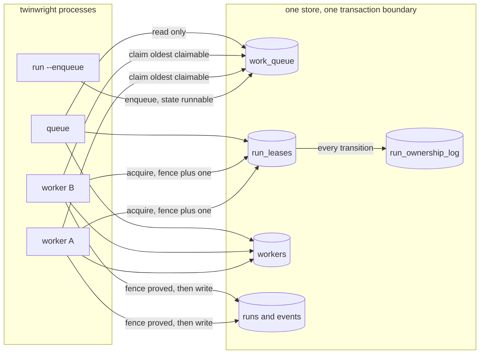
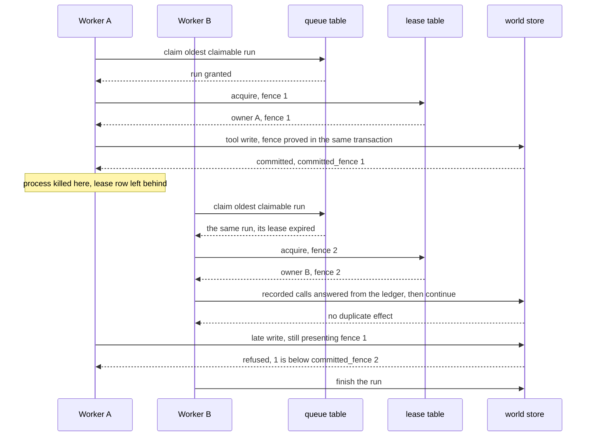
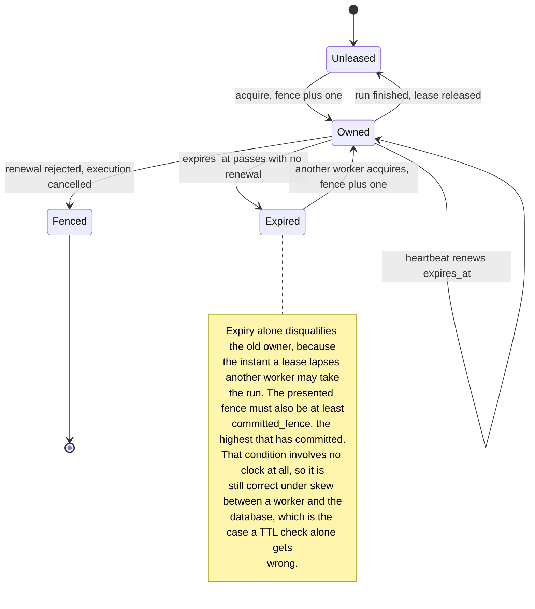

# The distributed runtime

Twinwright runs one incident on one process by default. It can also run a fleet
of workers over one database, which is what makes crash recovery something the
project measures rather than describes. This page is the picture of that, and
every database identifier below is checked against the schema by
`TestDistributedDiagramsNameOnlyRealSchemaIdentifiers` in
`internal/store/diagrams_test.go`, so a renamed table breaks the diagram that
names it.

What this is: a multi-worker runtime over one database. What it is not: a
multi-region system, a broker, or a shard map. ADR 0020 records why a broker was
rejected, since the queue needs claim-one-row-atomically and
take-over-on-expiry, which PostgreSQL provides in the same transaction as the
lease.

## Topology

`twinwright run --enqueue` queues a run. `twinwright worker` claims, executes
and finishes runs. `twinwright queue` reports depth, fleet and ownership. It
opens the database read-only, so it writes nothing: it does not apply a pending
migration, which matters while workers on an older build are still running, and
it refuses a path that does not exist instead of creating a database there
(`TestReadCommandsDoNotMigrateTheSource`, `TestReadCommandsRefuseAMissingDatabase`).



A worker claims the oldest run that is runnable, or one marked leased whose
lease has expired, which is exactly what a killed process leaves behind.
Recovery needs no janitor: the next poll picks the run up. On PostgreSQL the
candidate row is taken with `FOR UPDATE ... SKIP LOCKED`, so simultaneous
pollers take different runs instead of contending. SQLite has a single writer,
so the transaction alone provides that exclusion.

Ownership history is in `run_ownership_log`, not in the run's ledger. Fork
lineage and checkpoint reconstruction digest a run's event prefix, so if
ownership transitions lived there an identical agent trajectory would digest
differently depending on which worker executed it and how often the lease
changed hands. Keeping the ledger a pure record of what the agent did is what
lets a distributed run and a single-node replay produce byte-identical ledgers.

## A worker dies mid-run

Delivery is at-least-once. Exactly-once delivery is not claimed anywhere in
this codebase, because it is not achievable across a process boundary and a
database. The effect is made idempotent instead: the dispatcher looks up the
call by its identifier before executing, and a repeated call returns the
recorded status and body while committing nothing. The same identifier with
different arguments is refused rather than answered from the cache, so a cache
hit can never stand in for a different request. How far that idempotency
reaches, and where it does not, is under Crash boundaries below.



The last two exchanges are the ones worth reading twice. A stalled worker that
wakes up and writes is the failure a lease alone does not prevent, and the
refusal is why a duplicate delivery is safe rather than merely unlikely. The
project's bench suite injects exactly this: `examples/bench/flagship.yaml`
crashes the first worker at three points in a sixteen-call trajectory and
requires a takeover, a duplicate delivery and a refused stale commit on each.

## The lease, and why the clock is not trusted



Every acquisition increments the fence, including re-acquisition by the same
owner. A worker that lost contact and reconnected must not keep using its old
token, because the run may have been taken over and handed back in between.

While a run executes the worker renews on a timer, and a rejected renewal
cancels the execution context immediately. Continuing would spend model calls on
work this worker is no longer permitted to commit.

## Crash boundaries

A process can die at seven places in a run. Each is a named point in
`internal/crashpoint`, fired by a hook on the runner and the dispatcher that is
nil in production. The table says what is durable at the moment of death and
which test shows a second worker recovering from it. ADR 0029 has the reasoning.

| Point | Durable state at death | Proven by |
| --- | --- | --- |
| `before-model-request` | previous step fully committed; no request for this turn | `TestCrashMatrixSQLite` |
| `after-model-request` | `model.request` committed; no response | `TestCrashMatrixSQLite`, `TestRealProcessDeathIsRecovered` (occurrence 2) |
| `after-model-response` | turn committed (response, step, transcript); its tool calls not dispatched | `TestCrashMatrixSQLite`, `TestRealProcessDeathIsRecovered` (occurrence 3) |
| `before-tool-commit` | inside the tool transaction with every write staged, not committed | `TestCrashMatrixSQLite`, `TestRealProcessDeathIsRecovered` (`createRefund`, occurrence 1) |
| `after-tool-commit` | tool transaction committed (effect, events, saved result, transcript) | `TestCrashMatrixSQLite`, `TestRealProcessDeathIsRecovered` (`createRefund`, occurrence 1) |
| `before-completion` | final answer committed; run not marked completed | `TestCrashMatrixSQLite` |
| `after-completion` | run completed; queue entry not finished | `TestCrashMatrixSQLite` |

What each test is:

- `TestCrashMatrixSQLite` crashes every occurrence of every point for three
  scenarios: `duplicate-charge` (25 cases), `ambiguous-commit` (15) and
  `company-incident` (80). That is 120 cases, with zero violations. After each
  crash the lease is expired, a second worker takes over, and the harness checks
  the invariants in `internal/crashmatrix/verify.go`: a strictly higher fence and
  a reported takeover, the number of committed agent mutations equal to an
  uncrashed run's with no call ID committed twice, per-table world row counts
  equal to the reference, the recovered ledger verifying under `replay.Verify`,
  the latest checkpoint at or before the crash and the final checkpoint
  reconstructing, model requests equal to responses, and the dead worker's fence
  refused for a new call, for an already committed one and for the runner's own
  writes (a model turn and a status change).
- `TestCrashMatrixPostgres` runs the first and last occurrence of each point on
  PostgreSQL when `TWINWRIGHT_TEST_POSTGRES_DSN` is set. It is skipped without a
  server. The `postgres` job of the Integration workflow sets the DSN and runs
  `go test -count=1 ./...` against PostgreSQL 16 and 17, so every PostgreSQL-gated test
  runs there. That job passed on every Integration run of this branch on 2026-10-28,
  so the PostgreSQL half of the table has been run against a server.
- `TestRealProcessDeathIsRecovered` (unix only) re-executes the test binary as a
  worker that sends itself `SIGKILL` at the crash point, so the database has to
  cope with a client that vanished, possibly mid-transaction. It covers four
  crashes: `after-model-request` occurrence 2, `after-model-response`
  occurrence 3, and `before-tool-commit` and `after-tool-commit` on the first
  `createRefund`. The `before-tool-commit` case asserts no refund exists before
  recovery and the `after-tool-commit` case that exactly one does. The kill is
  sent before the run context is cancelled, by construction in `CrashWith`,
  because the other order lets `database/sql` roll the transaction back in an
  orderly way. `TestRealProcessDeathIsRecoveredPostgres` repeats the
  two tool-commit crashes against a server when a DSN is set.

The three points not marked with `TestRealProcessDeathIsRecovered` are covered by
the in-process matrix only. `after-completion` is never reached by code, since
nothing runs after the completed status is written; the harness simulates it by
skipping `FinishRun`.

### What these tests do and do not say about duplicates

A world mutation commits at most once per (run, call ID): the effect, its ledger
events, its saved result and its transcript entry commit in one transaction that
first proves lease ownership. A resumed runner dispatches only calls with no tool
message in the transcript, and that message commits with the effect, so recovery
does not present a committed call again. The saved-result lookup still answers a
repeated (run, call ID) pair, and a provider turn that reuses a call ID within a
run is refused (`TestProviderCallIDReuseFailsTheTurn`).

Model calls are at-least-once. A crash before a response is recorded repeats the
provider call, and its cost. A retry with a new call ID is a new logical action
and is not deduplicated, which is what the `ambiguous-commit` scenario measures.
Provider spend, logs and metrics are not fenced.

### The delivery bound

A delivery that never reports back counts toward `MaxAttempts` (default 3). When
a claim's attempts exceed it, the worker does not execute the run. A run that is
already `completed` is finished normally. Any other run is failed in one fenced
transaction, which appends the ledger event
`{"kind":"delivery_limit","deliveries":N,"max_attempts":M}` and fails the queue
entry. `Outcome.Takeover` is true only when the claim displaced an expired lease,
and re-enqueueing a run resets its count, so an operator retry gets a fresh
budget. A run retried that way can complete but cannot be verified by replay,
because its ledger records the `delivery_limit` error and an unanswered model
request; `TestRetryAfterTheDeliveryLimitCompletesButDoesNotReplay` pins it and
ADR 0029 lists it under remaining limits. The tests are in
`internal/worker/delivery_test.go`.

### Timestamps

Times in `run_leases`, `work_queue` and `workers` are written as
`2006-01-02T15:04:05.000000000Z` in UTC, so that comparing them as text in SQL
orders them as times. Migration 3 rewrites existing rows and refuses a value it
cannot parse, naming the table, column and row. Stop workers running an older
build before applying it: an older build keeps writing the variable-width form,
and mixed forms misorder within a second.

### Local execution

`run` without `--enqueue`, and `resume`, hold a lease owned by
`local-<host>-<pid>` with a 15 second TTL, renewed while they execute and released
on exit, including on Ctrl-C and `SIGTERM`. A run leased by a live fleet worker is
refused with the owner and expiry named. After `kill -9` the lease stays until it
expires, so `resume` is refused for up to 15 seconds.

#### Ctrl-C, a second Ctrl-C, and what is left behind

The release at the end of a local run deliberately ignores the command's
cancellation, because Ctrl-C is the case the release exists for. A release with no
deadline of its own would let a stalled database hold the process open after
Ctrl-C, so it is bounded: `releaseTimeout` in `internal/worker/local.go` is 5
seconds. `TestReleaseContextSurvivesCancellationButIsBounded` in
`internal/worker/local_test.go` holds both halves, that cancelling the command does
not reach the release and that its deadline is about 5 seconds away.

A second Ctrl-C ends the process without waiting for the release.
`executeLocally` in `cmd/twinwright/distributed.go` calls
`context.AfterFunc(signalCtx, stop)`, which stops the signal handler as soon as the
first signal arrives, so a later signal reaches the default handler and the process
exits. **No test covers this.** Showing it needs a real process that receives two
signals, and none has been written.

If the release is cut short, skipped by that second Ctrl-C or fails, the lease is
left to lapse on its own TTL, 15 seconds for a local run
(`TestExecuteLocalDefaultsToTheShortLocalTTL`), after which `resume` is accepted. A
failed release is reported next to the cancellation, never swallowed
(`TestExecuteLocalReportsAFailedReleaseAfterCancellation`), and the takeover of an
expired lease is held for every lease by `TestClaimRunStillTakesOverAnExpiredLease`.
No test interrupts a local run twice, waits out the TTL and then resumes it, so the
whole sequence is covered in pieces only.

An interrupted run tells you what to do. The error reads
`run R-1 interrupted; resume it with `twinwright resume R-1``, followed by the
cause, and it is not worded as a failure, because the run is intact and `resume`
picks it up. `TestLocalRunErrorSaysWhatActuallyHappened` in
`cmd/twinwright/main_test.go` pins the wording.

### Limits

`fork`, `counterfactual` and the non-distributed `bench` modes execute their own
new runs without a fence, and so does the shadow simulation. `bench` distributed
mode runs through the fenced `crashmatrix` harness. The real-process test kills
processes one at a time and does not show concurrent multi-process contention on
one SQLite file. The matrix covers three scenarios.

### Scraping a fleet

The gauges read from the database at scrape time (queue depth, run statuses, tool
calls, retries, authorization denials, chaos injections, ownership transitions, the
age of the oldest runnable entry) are served by every worker for the database it
points at. With several workers on one database each of them reports the same
numbers. Scrape one worker, or aggregate with `max`, never `sum`: a sum multiplies
every one of those gauges by the number of workers. The counters that are
in-process (claims, dispositions, takeovers, fencing rejections, lease renewals,
execution seconds) belong to one worker each and are the ones to sum.
`TestRenderReportsQueueRunAndLedgerState` holds what the gauges report. Serving them
once for the fleet was left out, and ADR 0032 lists this among its limits.

## Seeing it happen

```
twinwright bench --suite-file examples/bench/flagship.yaml
twinwright queue --db <dsn>
twinwright demo --dir <dir>     # step 8 crashes a worker and shows the takeover
```

The crash tests advance a controlled clock past the lease TTL rather than
sleeping it out, so the whole distributed section of the demo finishes in about
half a second. Every recovered run is replayed and required to verify, which is
what makes "byte-identical ledgers" a measurement instead of a claim.
